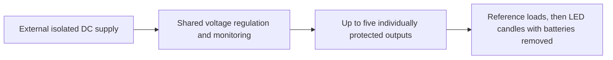
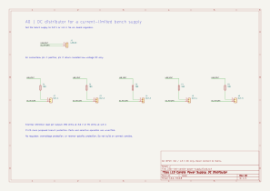
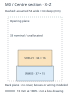

# 230 V Mains-Powered LED Candle Supply — V1

**Concept only. No 230 V schematic, installation approval, or manufacturing release.**

The eventual design takes 230 V AC mains input and provides a shared, securely configurable, isolated DC voltage for one to five LED candles, with individual protection for each output. A separate Shelly relay is intended to handle scheduling in the eventual installation. The final power-supply rating is open. The first prototype uses only low-voltage DC from an external, isolated, current-limited supply. The reference settings are 3.0 V and 4.5 V; the 1.5–6 V range is optional.

This diagram describes the V1 goal. The A0 schematic below covers only the DC distributor.

## KiCad schematic — revision A0

The [editable DC distributor schematic](230v-led-candle-power-supply.kicad_sch) targets KiCad 10.0.8. J1 receives 3.0 V or 4.5 V directly from an isolated, current-limited bench supply. F1–F5 show where branch protection is intended; no fuses have been selected or approved. A0 does not implement voltage regulation, overvoltage protection, or reverse-polarity protection. It has not been built or tested with candles.

The [A0 ERC report](docs/erc-a0.json) shows zero violations in KiCad 10.0.8. The KiCad netlist also contains all seven expected nets. These checks do not approve the design for construction or installation.

## Low-voltage test plan

**E1 design assumption:** budget 20 mA per candle in normal operation and design the distributor for 50 mA continuous per output at either voltage (250 mA total; up to 1.125 W delivered at 4.5 V). This is available current, not current to force through a candle, a measured peak, or a fuse rating. The final supply must also account for conversion losses, temperature and transient response.

Two commercial examples inform the nominal assumption. The [Goobay 64786 manual](https://www.pollin.de/media/fa/6f/01/1742196926/D521850-B.pdf) specifies one LED per candle and 0.06 W/LED at a 3.0 V operating voltage. The [Goobay 74368 manual](https://www.wentronic.com/media/perfion/perfion-product/74368_Bedienungsanleitung%23Manual.pdf) specifies 0.06 W/LED and 4.5 V operation. Dividing those figures by the respective supply voltage gives 20 mA and 13.3 mA as power equivalents, **not** measured battery-terminal currents. Neither figure establishes startup peaks or covers moving-flame and multi-LED models. Use reference loads until each candle model is characterized; coin-cell candles may rely on cell impedance and are not qualified for direct connection.

| Setpoint | Load per output | Current per output | Total current for five outputs | Power per load |
|---|---:|---:|---:|---:|
| 3.0 V | 150 Ω | 20.0 mA | 100.0 mA | 0.060 W |
| 3.0 V | 60 Ω | 50.0 mA | 250.0 mA | 0.150 W |
| 4.5 V | 225 Ω | 20.0 mA | 100.0 mA | 0.090 W |
| 4.5 V | 91 Ω | 49.45 mA | 247.25 mA | 0.223 W |

The figures follow from I = V/R and P = V²/R. Use 1% resistors rated for at least 0.5 W, with adequate ventilation and appropriate derating. These are reference loads, not measured candle characteristics. The test plan does not cover 6 V.

1. At each setpoint, test with no load, one output loaded, and five outputs loaded. Test power-up and load steps. Record current, temperature, and voltage at the supply or regulator and at the farthest load. Use an oscilloscope to capture brief spikes.
2. After branch protection has been implemented, use only reference loads and a current-limited source to test a short on one output. Record the fault current and the behavior of the other outputs. The target is to limit or disconnect the faulty output without driving the others outside their acceptable range. Verify this with the common supply current limit in effect.
3. Evaluate reverse polarity, incorrect voltage selection, and regulator failure separately. Overvoltage protection must match the selected output: a fixed 6 V threshold cannot protect a 3 V candle. Record overload behavior and temperature. No hardware tests have been performed yet.
4. For each selected candle, check polarity, steady-state and peak currents, timer behavior, and restart after loss of power. A regulated supply can deliver more current than a coin cell; nominal battery voltage alone is not enough. Remove batteries before applying external power. Establish acceptable voltage and current limits before finalizing the design.

## Flush-mount box fit study

[Print the two M0 fit gauges and follow the loose-box test](mechanical/README.md). Digitally checked; not yet physically tested. These blocks represent only the relay and module bodies, not the complete assembly.

The reference box is the **KAISER UP¹ 1555-05** (EAN 4013456594937). The [KAISER data sheet](https://www.kaisergroup.com/assets/media/21/21577/Datasheet_1555-05_%28EAN_4013456594937%29_en_KAISER.pdf) lists a 66 mm product depth, a 60 mm diameter device opening, an 82 mm diameter wall cutout, and four groups of three screw bosses. The 82 mm dimension is not an internal diameter. [Elektrikshop](https://www.elektrikshop.de/kaiser-unterputzdosen-up1-1555-05-tief.html) lists 65 mm of internal depth; that is not the usable space after adding a cover, terminals, and wiring.

The reported clear width and usable depth are approximately **54 mm and 64 mm**, respectively. The [to-scale preliminary fit study](fit-study-1555-05.svg) assumes an ideal cylinder; a 54 mm clear diameter across its full depth has not been established. The [KAISER CAD portal entry](https://kaiser.partcommunity.com/?languageIso=en&catalog=kaiser&part=1555-05) is available, but the model download was blocked in this environment.

The [Shelly 1 Mini Gen3](https://www.shelly.com/products/shelly-1-mini-gen3) measures 29 × 34 × 16 mm nominally. The [PCB-mount Mean Well IRM-03](https://www.meanwell.com/Upload/PDF/IRM-03/IRM-03-SPEC.PDF) measures 37 × 24 × 15 mm. Their footprint diagonals are 44.7 mm and 44.1 mm, respectively, so each bare bounding box fits in the idealized cross-section on its own. Their thicknesses add up to 31 mm. The remaining 33 mm is a nominal depth budget, not confirmed clearance: it excludes the PCB, pins, enclosure, terminals, cable routing, and required spacing. This is not a proposed mounting arrangement or proof of fit.

A 3D study must account for the actual box profile, cover, screw bosses, relay, power supply, PCB, enclosure, terminals, and cable bends. Check the insertion path, terminal access, and collisions. Geometric fit does not establish electrical separation, protection against contact, or adequate cooling. A remotely mounted supply remains an option. A qualified electrician must assess the fixed installation, including the applicable overvoltage category, protection, and enclosure, before any mains PCB layout or installation.

## Components and manufacturing

Preliminary candidates: [Mean Well IRM-03-5 / IRM-03-9](https://www.meanwell.com/Upload/PDF/IRM-03/IRM-03-SPEC.PDF), [Diodes AP63201WU-7](https://www.diodes.com/part/view/AP63201), and [Shelly 1 Mini Gen3](https://www.shelly.com/products/shelly-1-mini-gen3). The IRM-03's overvoltage category II rating does not by itself establish suitability for this installation. A buck converter cannot produce 6 V from a 5 V input. Producing 4.5 V from 5 V requires verifying regulation headroom under supply tolerances and load. No power module has been selected.

For JLCPCB assembly, verify availability, LCSC part numbers, footprints, polarity, and the planned SMT or through-hole process before ordering. Generate Gerbers, the BOM, and component placement data only from the reviewed design. Open inputs: usable box geometry, the actual candle model, maximum cable length, and connector type.

See the [development plan](docs/development-plan.md) for the remaining work.
