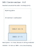

# M0 — unpowered fit gauge for the KAISER UP¹ 1555-05

Print these two loose blocks to check whether the **nominal component bodies** can pass the opening of an empty, uninstalled sample box, individually and in a trial stack. They are not electrical parts, a mount, or a protective enclosure. Never put the prints in an installed or wired box.

| Print one of each (STL in mm) | Represents | X × Y × Z, mm |
|---|---|---:|
| [Shelly dummy](m0-shelly.stl) | Shelly 1 Mini Gen3 | 34 × 29 × 16 |
| [Module dummy](m0-irm03.stl) | Mean Well IRM-03 candidate, body only | 37 × 24 × 15 |

Dimensions come from the [project fit study and its source links](../README.md#flush-mount-box-fit-study). The 60 mm device opening, 82 mm wall cutout and 66 mm product depth are distinct from the **reported** approximately 54 mm clear width and 64 mm depth. The dashed rectangle below is a centre section of that assumed space, not measured box geometry. X follows the long side of each block; Y runs into the page. Print the drawing at actual size and check the scale bar.



## Print and try

1. Import both STLs as millimetres at 100%, flat face down as exported. No supports required. A typical starting point is PLA, 0.2 mm layers, two or more walls and light infill. No clearance has been subtracted. Remove brim or flash without rounding the gauge; label each with a pen.
2. Measure X, Y and Z on the finished prints with calipers, including any first-layer flare. Record actual sizes. If a print is undersize it can give a false pass; if oversize it can give a false interference. Reprint if the error is comparable to the apparent gap.
3. With the loose box opening upward, try each block separately without force. Then place the module at the back and the relay on top, long sides parallel and centred as shown. Compare sequential loading with passage of the two held together, if retrievable. Stop at first contact. Tip the loose box to remove the blocks; do not wedge them behind bosses.
4. Record sample part number, orientation relative to the screw bosses, insertion order, first contact location and depth from the rim, and distance from the rim to the stack top. Note whether **both insertion and removal** worked. Check the intended loose cover separately, without force. Record a result only for the tested sample and orientation.

The bodies total 31 mm in Z. The other 33 mm in the assumed section is **not verified clearance**. Sharp-cornered blocks may foul where a rounded body would pass. Conversely, a pass ignores pins, carrier PCB, housing, terminals, wire entry and bends, fastening, tolerances and screwdriver access. Bosses and cover intrusions are tested only to the extent present in the physical sample. M0 does not assess heat, insulation, touch protection or 230 V suitability. No physical fit result is claimed.

## Rebuild and verify

From this directory in a Python 3.13 virtual environment:

```sh
python -m pip install cadquery==2.8.0 trimesh==5.2.1
python m0.py
python validate.py
```

[Editable CadQuery model](m0.py): edit `PARTS`, `WIDTH` and `DEPTH` for a new study. [Validation](validate.py) deliberately keeps the M0 reference sizes independent; review these separately for a new revision. The build checks each CAD solid before export. The validator reloads each STL, checks solid topology, dimensions, bed plane and volume, and checks the section rectangles and physical SVG scale. [Recorded digital check](validation.txt). A digital pass is not a printer calibration or a sample-box test.
